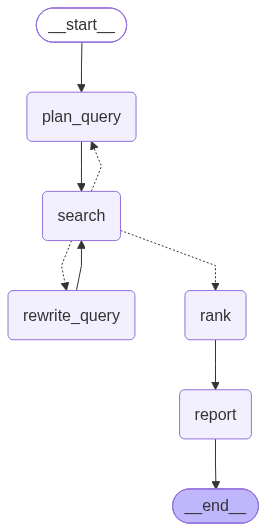

# Job Search Agent

A personal job-search agent that autonomously searches for relevant jobs, ranks them against your CV, and surfaces a shortlist — with a Streamlit UI, full LLM observability via Opik, and offline evaluation using precision@10 and NDCG@10.

Built as a portfolio project to demonstrate the full AI Engineering stack: structured LLM output, agentic loops with LangGraph, hybrid ranking, observability, offline evals, and a production-grade UI.



---

## Features

- **CV Parsing** — extracts structured `CandidateProfile` from a PDF using OpenAI structured output (no regex, no manual parsing)
- **Agentic Search** — LangGraph agent searches across multiple roles and locations; rewrites queries and retries if results are sparse
- **Hybrid Ranking** — embedding pre-filter (cosine similarity) shortlists candidates cheaply; LLM judge scores each on skills, seniority, location, and salary
- **Company Scoring** — persistent cache of LLM-scored company reputation; compounds savings across runs
- **Full Observability** — every LLM call traced in Opik with token counts and cost; per-run tags and metadata
- **Offline Evals** — precision@10 and NDCG@10 against a labelled snapshot; Opik Experiments tracks results across weight configurations
- **Streamlit UI** — Jobs tab with sortable table and detail cards; config editor with auto-rerank; progress bars on all backend calls

---

## Architecture

```
CV PDF
  │
  ▼
cv_parser.py  ─── pypdf + OpenAI structured output → CandidateProfile (Pydantic)
  │
  ▼
LangGraph Agent
  ├── plan_query   → construct search query from profile
  ├── search       → call JSearch API → list[Job]
  ├── route        → conditional: too few results? rewrite + retry (max 2)
  └── rank         → embedding pre-filter → LLM judge → list[RankedJob]
  │
  ▼
Streamlit UI (app.py)
  ├── Jobs tab     → ranked table + detail card + Get New Jobs
  ├── Eval tab     → run precision@10 / NDCG@10 via Opik
  └── Label tab    → export CSV → label manually → import

Opik  ←── every LLM call traced: inputs, outputs, tokens, cost
```

**Two-stage ranking:**

1. **Embedding pre-filter** — embed all jobs + candidate profile in one batched API call; keep top-K by cosine similarity (cheap)
2. **LLM judge** — score each shortlisted job on skills_match, seniority_alignment, location_fit, salary_fit using `gpt-4o-mini` structured output (precise)

---

## Tech Stack

| Layer | Technology |
|---|---|
| Language | Python 3.14+ |
| Package manager | [uv](https://github.com/astral-sh/uv) |
| Agent framework | [LangGraph](https://github.com/langchain-ai/langgraph) |
| LLM provider | OpenAI GPT-4o-mini |
| Data validation | Pydantic v2 |
| Observability & evals | [Opik](https://www.comet.com/site/products/opik/) (Comet ML) |
| Jobs API | [JSearch](https://rapidapi.com/letscrape-6bRBa3QguO5/api/jsearch) (RapidAPI) |
| UI | [Streamlit](https://streamlit.io/) |
| PDF parsing | pypdf |

---

## Setup

### 1. Clone and install dependencies

```bash
git clone https://github.com/<your-username>/job-search-agent.git
cd job-search-agent
uv sync
```

### 2. Configure API keys

Create a `.env` file in the project root (never committed):

```
OPENAI_API_KEY=sk-...
RAPIDAPI_KEY=...
OPIK_API_KEY=...
OPIK_PROJECT_NAME=job-search-agent
```

- **OpenAI** — [platform.openai.com](https://platform.openai.com/)
- **RapidAPI / JSearch** — [rapidapi.com](https://rapidapi.com/letscrape-6bRBa3QguO5/api/jsearch) (free tier: 200 requests/month)
- **Opik** — [comet.com/opik](https://www.comet.com/site/products/opik/) (free tier available)

### 3. Add your CV

Place a PDF of your CV at `resume/cv.pdf`. The PDF must have a text layer (not a scanned image). The file is gitignored — it is never committed.

### 4. (Optional) Customise search targets

Edit the overrides at the top of `cv_parser.py`:

```python
PREFERRED_ROLES: list[str] = []          # empty → LLM infers from CV
SEARCH_LOCATIONS: list[str] = [
    "Delhi NCR", "Bangalore", "Remote",
]
```

---

## Usage

### Streamlit UI (recommended)

```bash
uv run streamlit run app.py
```

Opens at `http://localhost:8501`.

- **Jobs tab** — view ranked jobs, click a job for full description + LLM reasoning
- **Sidebar** — edit ranker weights, judge prompt, model; Save Config auto-rerankss jobs
- **Get New Jobs** — upload an optional new CV and run the agent to fetch a fresh job pool
- **Eval tab** — name and run an experiment; results logged to Opik
- **Label tab** — export jobs to CSV, label manually, import labels for eval

### CLI

```bash
# Run the agent (fetch + rank jobs)
uv run python agent.py

# Save a snapshot of raw jobs for evaluation
uv run python agent.py --snapshot

# Export jobs to CSV for manual labelling
uv run python label_jobs.py --export

# Import labelled CSV back
uv run python label_jobs.py --import

# Run evaluation (precision@10, NDCG@10) → logged to Opik
uv run python eval.py

# Re-rank existing snapshot with current config (no LLM calls)
uv run python rerank.py --reweight-only

# Re-score all snapshot jobs via LLM judge
uv run python rerank.py
```

---

## Evaluation Results

Experiments run against 46 manually labelled jobs from a fixed snapshot. All post-baseline runs use cached LLM scores (zero additional API cost).

| Experiment | w_skills | w_seniority | w_location | P@10 | NDCG@10 |
|---|---|---|---|---|---|
| Clean baseline | 0.50 | 0.25 | 0.25 | 0.800 | 0.559 |
| Reduce seniority | 0.65 | 0.10 | 0.25 | 0.800 | 0.660 |
| Zero seniority | 0.75 | 0.00 | 0.25 | 0.800 | **0.689** |

**Key finding:** seniority weight was the most damaging dimension for a career transitioner — the LLM judge penalised role-title mismatches even when actual skill overlap was strong. Zeroing it gave the largest NDCG gain (+0.13 over baseline) without hurting precision.

**Precision ceiling at 0.800:** 2 non-relevant jobs score highly on both skills and location regardless of weight configuration. Breaking through requires a stricter judge prompt, not weight tuning — left as a future improvement.

---

## Project Phases

| Phase | What was built |
|---|---|
| 0 | Project setup; Opik observability smoke test |
| 1 | CV parsing — PDF → `CandidateProfile` via OpenAI structured output |
| 2 | Job search tool — JSearch API → normalised `Job` Pydantic objects |
| 3 | LangGraph agent — search loop with retry + rewrite on sparse results |
| 4 | Hybrid ranking — embedding pre-filter + LLM judge + company quality cache |
| 5 | Full Opik tracing — root trace, per-node spans, cost/token metadata |
| 6 | Offline evals — labelled snapshot, precision@10 + NDCG@10 via Opik Experiments |
| 7 | Streamlit UI — jobs table, config editor, progress bars, auto-rerank |

---

## File Structure

```
job-search-agent/
├── models.py              # all Pydantic data models (Job, CandidateProfile, JobScore, ...)
├── cv_parser.py           # Phase 1: PDF → CandidateProfile
├── job_search.py          # Phase 2: JSearch API wrapper
├── agent.py               # Phase 3: LangGraph agent graph
├── ranker.py              # Phase 4: embedding pre-filter + LLM judge
├── eval.py                # Phase 6: precision@10 / NDCG@10 via Opik
├── label_jobs.py          # Phase 6: CSV export/import for manual labelling
├── rerank.py              # Phase 7: re-score or reweight snapshot jobs
├── app.py                 # Phase 7: Streamlit UI
├── ranker_config.json     # default ranker weights (edit via UI or directly)
├── pyproject.toml         # uv project manifest
├── uv.lock                # locked dependency versions
└── agent_graph.png        # LangGraph visualisation
```

**Runtime files (gitignored, generated on first run):**

| File | Contents |
|---|---|
| `resume/cv.pdf` | Your CV — never committed |
| `.env` | API keys — never committed |
| `jobs_snapshot.json` | Raw job pool from last agent run |
| `ranked_jobs.json` | Scored + ranked jobs for UI display |
| `labels.json` | URL → relevance label map |
| `job_scores_cache.json` | Cached LLM dimension scores (saves API cost on repeat evals) |
| `company_cache.json` | Cached company reputation scores |
| `ui_state.json` | UI state persistence across Streamlit restarts |

---

## Cost

A typical run (5 roles, no retries, 15 LLM judge calls, 10 new companies) costs approximately **$0.002–0.005**. Caching means repeat evals and reweighting runs cost nothing.

---

## License

MIT
